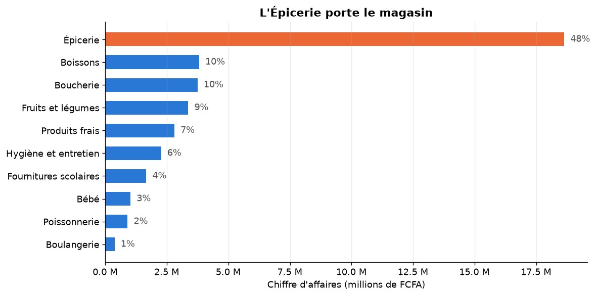
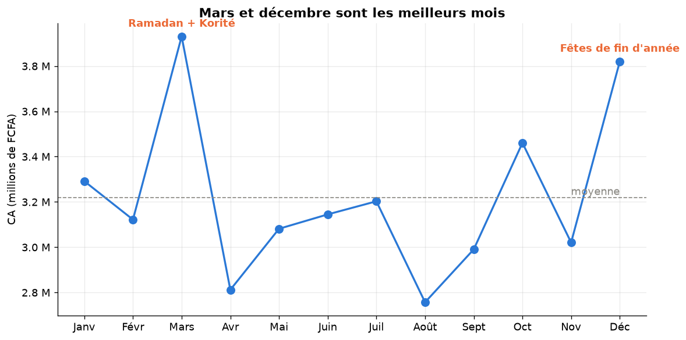
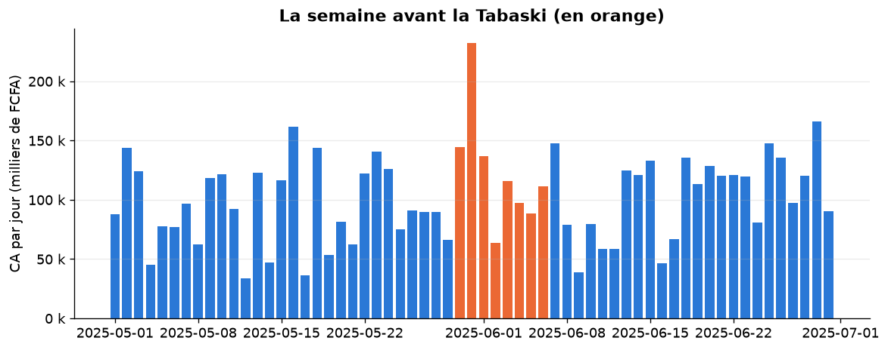
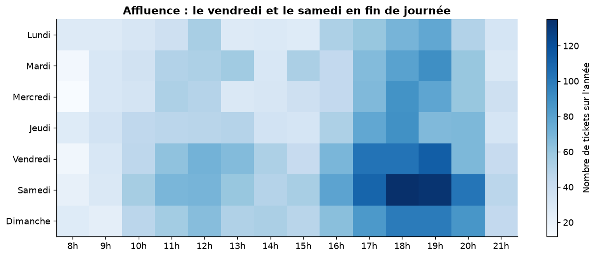
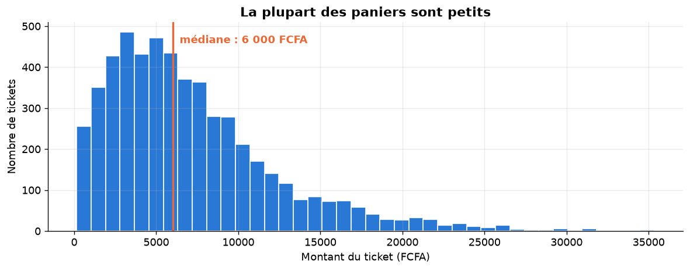
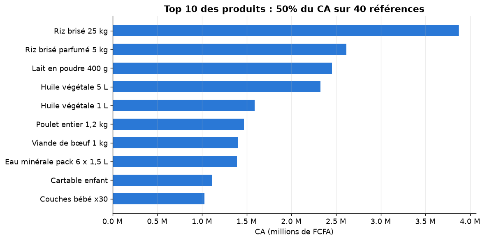
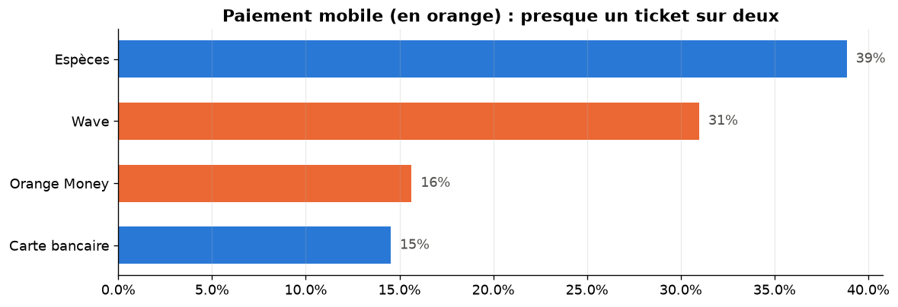
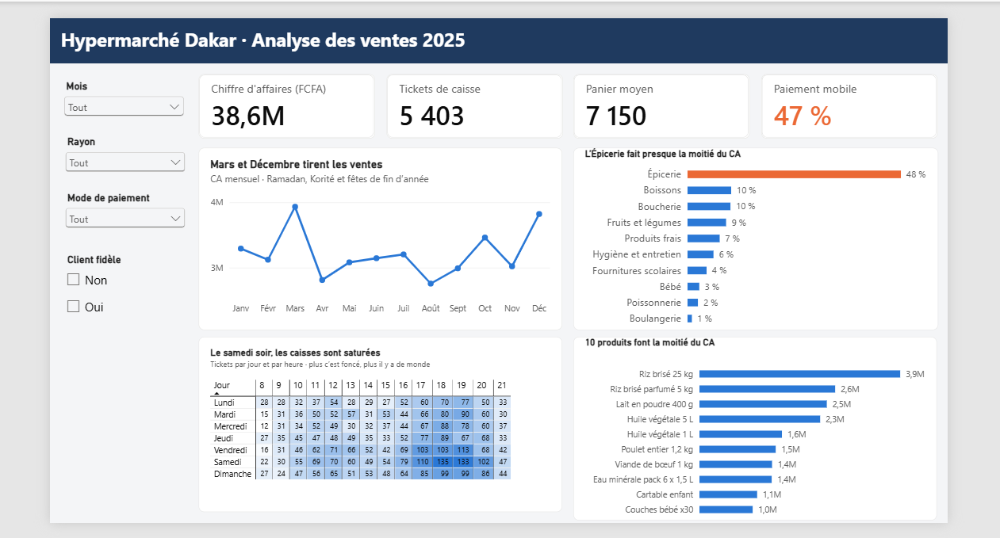

# 🛒 Analyse des ventes d'un hypermarché à Dakar : où se cache le chiffre d'affaires ?

> **En une phrase :** j'ai nettoyé et analysé **17 604 lignes de ventes** (5 403 tickets de caisse,
> 38,6 millions de FCFA) d'un hypermarché pour aider la direction à mieux gérer
> **ses caisses, ses stocks et son programme de fidélité**. J'en tire 3 recommandations chiffrées.

⚠️ **Données simulées.** Le jeu de données est fictif (voir [DONNEES.md](DONNEES.md)). Il a été
conçu pour reproduire le fonctionnement d'un hypermarché dakarois : produits locaux, prix en FCFA,
Wave et Orange Money, Ramadan, Tabaski, rentrée scolaire. Projet personnel, sans lien avec une enseigne réelle.

---

## 🎯 Le problème business

Le directeur d'un hypermarché doit répondre chaque semaine à des questions simples, mais coûteuses s'il se trompe :

1. Quels rayons rapportent le plus ?
2. Quand les clients viennent-ils ? (mois, jours, heures)
3. Quel est le panier moyen, et comment l'augmenter ?
4. Quels produits sont incontournables ?
5. Comment les clients paient-ils ?

## 🧹 Étape 1 : nettoyage des données

Le fichier brut contenait des erreurs, comme un vrai export de caisse :

| Problème trouvé | Lignes | Solution |
|---|---:|---|
| Espaces en trop dans le mode de paiement | 176 | Suppression des espaces |
| Catégories mal écrites (`Epicerie`, `EPICERIE`…) | 264 | Harmonisation |
| Dates au format JJ/MM/AAAA | 176 | Conversion en vraie date |
| Lignes en double | 171 | Suppression |
| Quantités manquantes | 88 | Suppression (0,5 % des lignes) |
| Quantités aberrantes (99 ou 999) | 15 | Suppression (seuil : 20 unités) |

**Impact :** sans ce nettoyage, **le CA d'août était surestimé 6,4 fois**. Les 15 quantités aberrantes
ajoutaient à elles seules environ 25 millions de FCFA de faux chiffre d'affaires. On aurait cru qu'août
était le meilleur mois de l'année, alors que c'est l'un des plus faibles.

## 📊 Étape 2 : résultats clés

**1. L'Épicerie porte le magasin : 48 % du CA.** Avec les Boissons, 2 rayons font 58 % du chiffre d'affaires.



**2. Mars (+22 %) et décembre (+19 %) sont les meilleurs mois**, portés par le Ramadan, la Korité et les fêtes de fin d'année.



**3. La semaine avant la Tabaski, le CA par jour augmente de 17 %.** Certains produits se vendent beaucoup plus que la normale :
viande de mouton (x3,6), pommes de terre (x2,7), huile (x2,6), oignons (x2,5).



**4. Le vendredi et le samedi concentrent 35 % des tickets**, et le créneau 18 h-21 h en concentre 34 %.



**5. Panier moyen : 7 150 FCFA (4,8 articles).** 40 % des tickets font moins de 5 000 FCFA.
**Surprise : les clients avec carte de fidélité dépensent autant que les autres.**



**6. 10 produits sur 40 font 50 % du CA**, avec le riz brisé 25 kg en tête.



**7. Le paiement mobile représente 47 % des tickets** (Wave 31 %, Orange Money 16 %), devant les espèces (39 %).



## 💡 Étape 3 : mes 3 recommandations

| # | Recommandation | Pourquoi (le chiffre) |
|---|---|---|
| 1 | **Renforcer les caisses le vendredi et le samedi, de 18 h à 21 h** | 35 % des tickets le vendredi et le samedi ; 34 % entre 18 h et 21 h |
| 2 | **Augmenter les stocks 10 jours avant la Tabaski et la Korité** (mouton, oignons, pommes de terre, huile, boissons) | Ventes multipliées par 2,5 à 4 ; une rupture = CA perdu |
| 3 | **Revoir le programme de fidélité** : avantages à partir d'un montant d'achat, compatibles Wave et Orange Money | Même panier avec ou sans carte (7 150 FCFA) ; 40 % des tickets < 5 000 FCFA |

### Limites
- Données **simulées** : les tendances sont réalistes, mais les chiffres ne décrivent aucun magasin réel.
- Pas de données de **marge** ni de **stock** : l'analyse porte sur le chiffre d'affaires, pas sur la rentabilité.
- Une seule année : pas de comparaison avec l'année précédente.

### Prochaines étapes
- Segmentation des clients (méthode RFM : récence, fréquence, montant)
- Analyse des produits achetés ensemble (*market basket analysis*)
- Tableau de bord interactif sous Power BI

## 🛠️ Outils et compétences

- **Python / pandas** : nettoyage (doublons, formats de date, valeurs aberrantes), agrégations, tableaux croisés
- **Matplotlib** : 7 graphiques pensés pour un public non technique
- **2 scripts Python commentés** : un pour le nettoyage, un pour l'analyse
- **Power BI** : mesures DAX, matrice avec mise en forme conditionnelle, segments, filtre Top N
## 📈 Tableau de bord Power BI

Pour rendre l'analyse utilisable par un directeur de magasin, j'ai construit un tableau de bord
interactif : 4 indicateurs clés, 4 graphiques et 4 filtres (mois, rayon, mode de paiement, fidélité).



- Fichier : [`powerbi/dashboard_ventes.pbix`](powerbi/dashboard_ventes.pbix) (à ouvrir avec Power BI Desktop)
- Version PDF : [`powerbi/dashboard_ventes.pdf`](powerbi/dashboard_ventes.pdf)
- Mesures DAX : CA, Nb tickets (DISTINCTCOUNT), Panier moyen, % paiement mobile (CALCULATE), Part du CA (ALL)
## 📁 Structure du projet

```
├── data/
│   ├── ventes.csv              # données brutes simulées (avec erreurs volontaires)
│   ├── ventes_propres.csv      # données nettoyées par 01_nettoyage.py (utilisées par Power BI)
│   └── generer_donnees.py      # script qui génère les données
├── scripts/
│   ├── 01_nettoyage.py         # étape 1 : nettoyage -> data/ventes_propres.csv
│   └── 02_analyse.py           # étape 2 : résultats + graphiques -> images/
├── powerbi/
│   ├── theme_projet.json       # couleurs du tableau de bord
│   └── GUIDE_POWER_BI.md       # étapes de construction du tableau de bord
├── images/                     # graphiques utilisés dans ce README
├── DONNEES.md                  # dictionnaire des données
├── requirements.txt
└── README.md
```

## ▶️ Reproduire l'analyse

```bash
pip install -r requirements.txt
python scripts/01_nettoyage.py
python scripts/02_analyse.py
```

## 👤 Auteur

**Moulaye Idrisse Haidara** · Étudiant(e) en informatique appliqueee a la gestion des entreprises · Futur(e) Data Analyst · Dakar
 [Email] haidaraidrisse69@gmail.com
