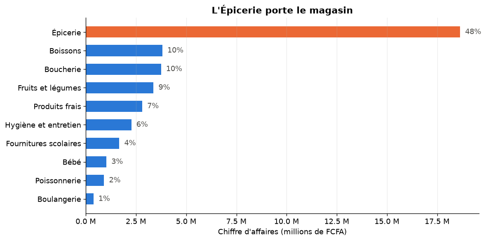
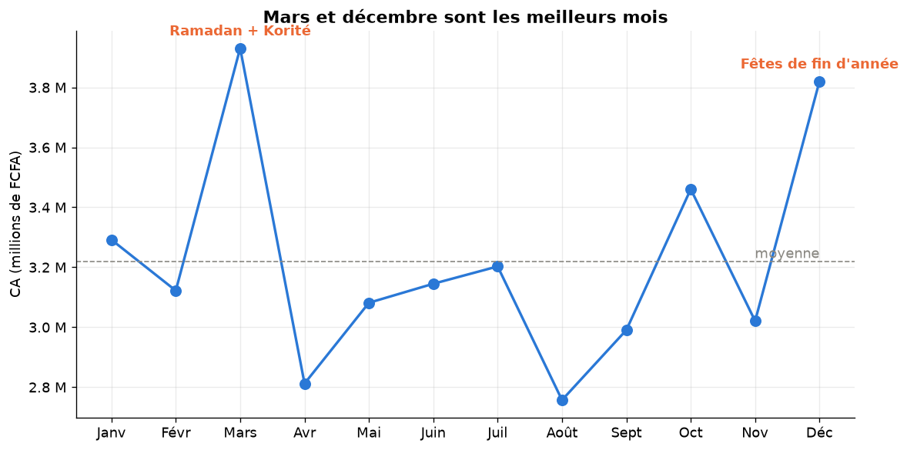
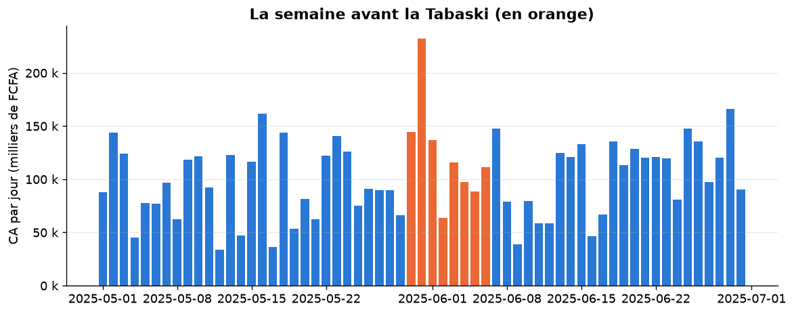
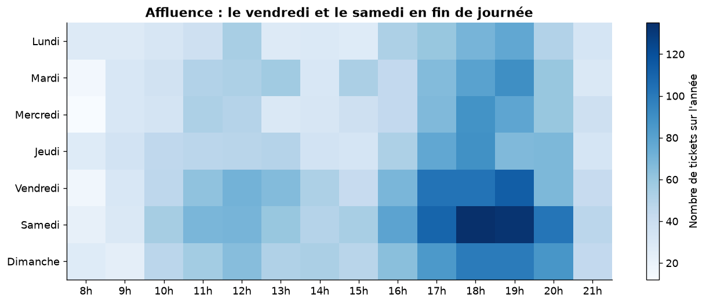
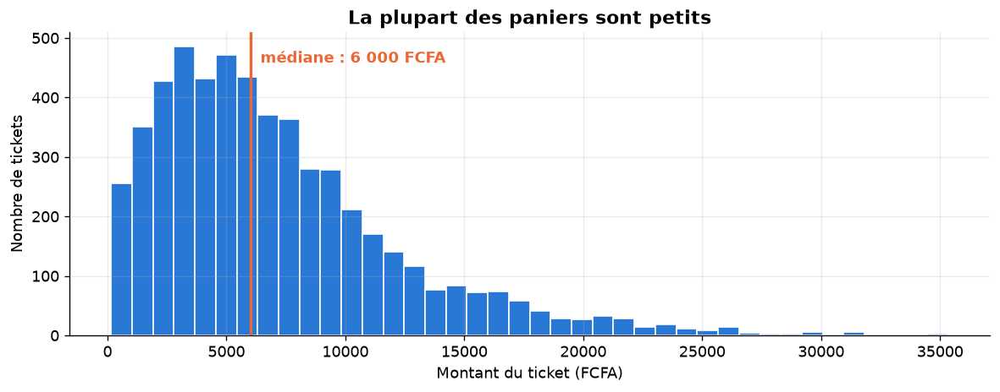
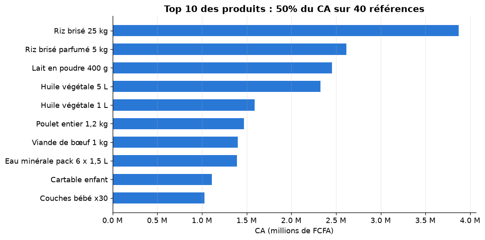
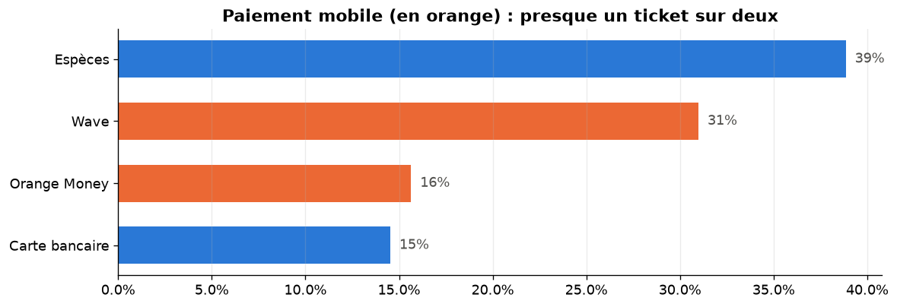
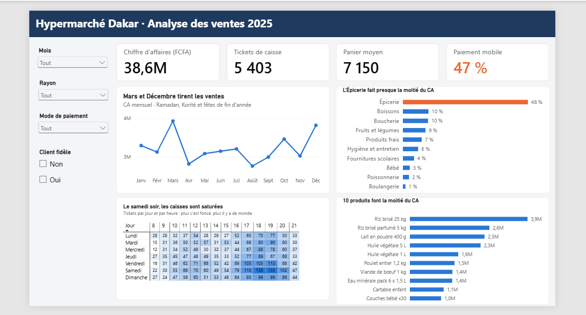

# 🛒 Analyse des ventes d'un hypermarché à Dakar

> **En une phrase :** j'ai nettoyé et analysé 17 604 lignes de ventes (5 403 tickets de caisse, 38,6 millions de FCFA) pour aider la direction d'un hypermarché à mieux gérer **ses caisses, ses stocks et son programme de fidélité**, puis j'ai présenté les résultats dans un tableau de bord Power BI.

⚠️ **Données simulées.** Le jeu de données est fictif (voir [DONNEES.md](DONNEES.md)). Il reproduit le fonctionnement d'un hypermarché dakarois : produits locaux, prix en FCFA, Wave et Orange Money, Ramadan, Tabaski, rentrée scolaire. Projet personnel, sans lien avec une enseigne réelle.

---

## 1. 🎯 Le problème

Le directeur d'un hypermarché prend chaque semaine des décisions qui coûtent cher s'il se trompe : combien de caisses ouvrir, quels produits commander avant une fête, comment inciter les clients à acheter davantage.

Mon projet répond à 5 questions :

1. Quels rayons rapportent le plus ?
2. Quand les clients viennent-ils ? (mois, jours, heures)
3. Quel est le panier moyen, et comment l'augmenter ?
4. Quels produits sont incontournables ?
5. Comment les clients paient-ils ?

## 2. 📦 La donnée

| | |
|---|---|
| **Source** | Données simulées, générées par [`data/generer_donnees.py`](data/generer_donnees.py) |
| **Période** | 1er janvier au 31 décembre 2025 |
| **Taille brute** | 17 604 lignes (une ligne = un produit dans un ticket), 5 403 tickets, 40 produits |
| **Colonnes** | ticket, date, heure, produit, rayon, quantité, prix (FCFA), montant, mode de paiement, carte de fidélité, caisse |
| **Particularités** | Pics autour du Ramadan, de la Korité, de la Tabaski, de la rentrée scolaire et des fêtes de fin d'année |

Le fichier brut contient volontairement des erreurs, comme un vrai export de caisse. Dictionnaire complet des colonnes : [DONNEES.md](DONNEES.md).

## 3. 🛠️ La méthode

### Étape 1 : nettoyer les données (`scripts/01_nettoyage.py`)

| Problème trouvé | Lignes | Solution |
|---|---:|---|
| Espaces en trop dans le mode de paiement | 176 | Suppression des espaces |
| Catégories mal écrites (`Epicerie`, `EPICERIE`…) | 264 | Harmonisation |
| Dates au format JJ/MM/AAAA | 176 | Conversion en vraie date |
| Lignes en double | 171 | Suppression (après l'harmonisation, sinon elles passent inaperçues) |
| Quantités manquantes | 88 | Suppression (0,5 % des lignes) |
| Quantités aberrantes (99 ou 999) | 15 | Suppression au-delà de 20 unités |

**Choix justifiés :**
- **Supprimer plutôt que corriger** les quantités aberrantes : on ne sait pas si 999 voulait dire 9, 99 ou 1. Corriger, c'était inventer une donnée.
- **Seuil à 20 :** les quantités normales vont de 1 à 6, puis il y a un grand vide jusqu'à 99. J'ai aussi testé la méthode IQR : elle aurait supprimé 363 lignes, dont des achats normaux de 4 à 6 articles.
- **`id_client` vide n'est pas une erreur :** c'est un client sans carte de fidélité, donc je l'ai gardé.

**Résultat :** 17 604 → 17 330 lignes, enregistrées dans `data/ventes_propres.csv`.

### Étape 2 : analyser (`scripts/02_analyse.py`)

Pour chaque question : calcul avec `groupby` (pandas), affichage des résultats, puis graphique Matplotlib. Les lignes sont regroupées par ticket pour calculer le panier moyen et l'affluence.

### Étape 3 : présenter (Power BI)

Un tableau de bord interactif, construit à partir du fichier nettoyé : 4 indicateurs, 4 graphiques, 4 filtres (mois, rayon, mode de paiement, fidélité). Les chiffres des cartes sont identiques à ceux du script Python.

## 4. 📊 Les résultats

### Ce que le nettoyage a changé

Sans nettoyage, **le CA d'août était surestimé 6,4 fois** : 17,8 M FCFA au lieu de 2,8 M. Les 15 quantités aberrantes ajoutaient à elles seules près de 25 M FCFA de faux chiffre d'affaires. On aurait cru qu'août était le meilleur mois de l'année, alors que c'est l'un des plus faibles.

### Ce que l'analyse montre

**1. L'Épicerie porte le magasin : 48 % du CA.** Avec les Boissons, 2 rayons font 58 % du chiffre d'affaires.



**2. Mars (+22 %) et décembre (+19 %) sont les meilleurs mois**, par rapport à un mois moyen. Ramadan, Korité et fêtes de fin d'année expliquent ces pics.



**3. La semaine avant la Tabaski, le CA par jour augmente de 17 %.** Certains produits se vendent beaucoup plus que d'habitude : viande de mouton (x3,6), pommes de terre (x2,7), huile (x2,6), oignons (x2,5).



**4. Le vendredi et le samedi concentrent 35 % des tickets**, et le créneau 18 h-21 h en concentre 34 %. Le pic : le samedi en fin de journée.



**5. Panier moyen : 7 150 FCFA (4,8 articles).** 40 % des tickets font moins de 5 000 FCFA. **Surprise : les clients avec carte de fidélité dépensent autant que les autres.**



**6. 10 produits sur 40 font 50 % du CA**, avec le riz brisé 25 kg en tête.



**7. Le paiement mobile représente 47 % des tickets** (Wave 31 %, Orange Money 16 %), devant les espèces (39 %) et la carte (15 %).



### Le tableau de bord Power BI



- Fichier : [`powerbi/dashboard_ventes.pbix`](powerbi/dashboard_ventes.pbix) (à ouvrir avec Power BI Desktop)
- Version PDF : [`powerbi/dashboard_ventes.pdf`](powerbi/dashboard_ventes.pdf)
- Mesures DAX : CA, Nb tickets (`DISTINCTCOUNT`), Panier moyen, % paiement mobile (`CALCULATE`), Part du CA (`ALL`)

### 💡 Mes 3 recommandations

| # | Recommandation | Pourquoi (le chiffre) |
|---|---|---|
| 1 | **Renforcer les caisses le vendredi et le samedi, de 18 h à 21 h** | 35 % des tickets le vendredi et le samedi ; 34 % entre 18 h et 21 h |
| 2 | **Augmenter les stocks 10 jours avant la Tabaski et la Korité** (mouton, oignons, pommes de terre, huile, boissons) | Ventes multipliées par 2,5 à 3,6 ; une rupture = chiffre d'affaires perdu |
| 3 | **Revoir le programme de fidélité** : avantages à partir d'un montant d'achat, compatibles Wave et Orange Money | Même panier avec ou sans carte (7 150 FCFA) ; 40 % des tickets < 5 000 FCFA |

### Limites
- Données **simulées** : les tendances sont réalistes, mais les chiffres ne décrivent aucun magasin réel.
- Pas de données de **marge** ni de **stock** : l'analyse porte sur le chiffre d'affaires, pas sur la rentabilité.
- Une seule année : pas de comparaison avec l'année précédente.

### Prochaines étapes
- Refaire les analyses en **SQL** (SQLite) pour comparer avec pandas
- Segmentation des clients fidèles (méthode RFM : récence, fréquence, montant)
- Analyse des produits achetés ensemble (*market basket analysis*)
- Évolution par rapport au mois précédent dans Power BI (`DATEADD`)

## 🧰 Outils et compétences

- **Python / pandas** : nettoyage (doublons, formats de date, valeurs aberrantes), `groupby`, tableaux croisés
- **Matplotlib** : 7 graphiques pensés pour un public non technique
- **Power BI** : mesures DAX, matrice avec mise en forme conditionnelle, segments, filtre Top N
- **Git / GitHub** : versionnement du projet
- **Démarche data analyst** : question business → nettoyage → analyse → recommandations

## 📁 Structure du projet

```
├── data/
│   ├── ventes.csv              # données brutes simulées (avec erreurs volontaires)
│   ├── ventes_propres.csv      # données nettoyées (utilisées par Power BI)
│   └── generer_donnees.py      # script qui génère les données
├── scripts/
│   ├── 01_nettoyage.py         # étape 1 : nettoyage
│   └── 02_analyse.py           # étape 2 : résultats + graphiques
├── powerbi/
│   ├── dashboard_ventes.pbix   # tableau de bord
│   ├── dashboard_ventes.pdf    # version PDF
│   ├── theme_projet.json       # couleurs du tableau de bord
│   └── GUIDE_POWER_BI.md       # étapes de construction
├── images/                     # graphiques utilisés dans ce README
├── DONNEES.md                  # dictionnaire des données
├── requirements.txt
└── README.md
```

## ▶️ Reproduire l'analyse

```bash
pip install -r requirements.txt
python scripts/01_nettoyage.py
python scripts/02_analyse.py
```

## 👤 Auteur

**[Moulaye Idrisse Haidara]** · Étudiant(e) en informatique appliquee a la gestion des entreprises · Futur(e) Data Analyst · Dakar
[LinkedIn] https://www.linkedin.com/in/moulaye-ha%C3%AFdara-a24071347 · [Email]  haidaraidrisse69@gmail.com